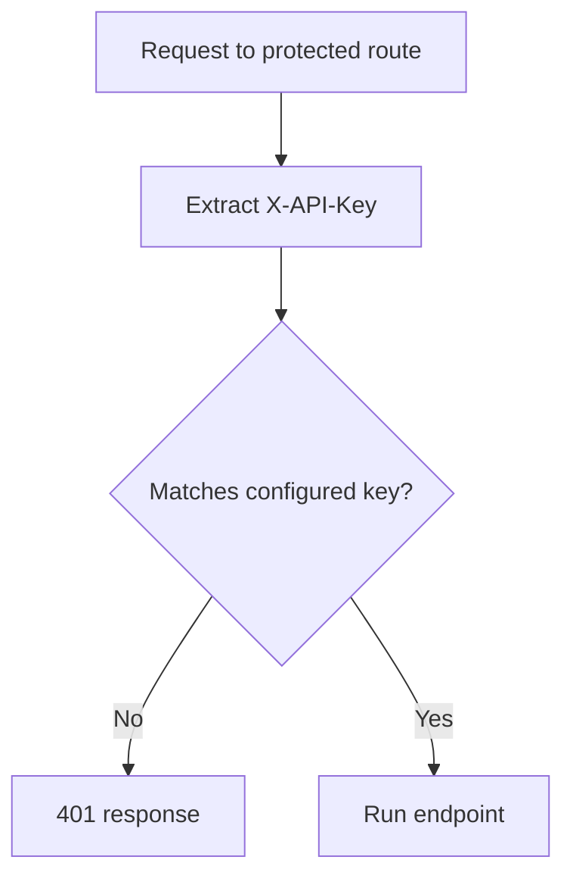

# Exercise 1 - API Key Authentication

## Overview

A public information route is harmless, but an internal status route should require a client credential. You will protect small read-only endpoints. An API key identifies a key holder or application; one shared key does not establish the identity of an individual person.

**Time:** 45 minutes core; challenge 10–15 minutes extra.
**Learning objectives:** separate extraction from verification; protect selected routes; keep credentials outside source; test rejected requests.

## Endpoint contract

Use this table as your build and test checklist. Data shapes describe JSON keys and types; they are not Python code. All requests use **no body**. Public endpoints do not check credentials. Protected endpoints accept the key **only in the `X-API-Key` header**, never in the URL.

| Method and endpoint | Request data / credential | Successful response data shape | Protected? | Expected statuses |
|---|---|---|---|---|
| `GET /public` | None | `{message: string}` | **No** | 200 |
| `GET /protected` | `X-API-Key: <local lab key>` | `{message: string}` | **Yes — valid lab key** | 200; 401 missing/wrong key |
| `GET /status` | `X-API-Key: <local lab key>` | `{status: string}` | **Yes — valid lab key** | 200; 401 missing/wrong key |
| `GET /lab-info` | `X-API-Key: <local lab key>` | Object with two non-sensitive strings, e.g. `{lab: string, access: string}`; choose and document your field names | **Yes — valid lab key** | 200; 401 missing/wrong key or key supplied only in query |
| Same protected endpoints | Current or next configured key in `X-API-Key` | Same shapes as above | **Yes — either configured rotation key** | 200 for either key; 401 for every other/missing key |

Authentication errors use `{detail: string}` with a generic message. Never put the key in any response. No create, update or delete endpoints are required.

## Before You Start

Complete the root README environment setup. Use a terminal in the repository root and ensure the virtual environment is active. Create the named folder in VS Code. All application files start empty; type or copy only the explained snippets below. Save each file before running it.

The examples use local HTTP only for a private development server. Real remote credentials require HTTPS. Never publish these teaching applications as production identity services.
## Part 1 - Guided Walkthrough (20 minutes)

### Create a public FastAPI application

Create `work/key-api/`, then create `main.py` there:

```python
from fastapi import FastAPI
app = FastAPI()

@app.get("/public")
def public():
    return {"message": "Anyone can read this"}
```

In the terminal, run:

```bash
cd work/key-api
python -m uvicorn main:app --reload
```

Open `/docs` and execute `GET /public`. Expect **200** and the message above. `main:app` names the Python file and the FastAPI object. A 404 means you reached a server but used a different route. An import error usually means the current folder or environment is wrong. Stop the server with Ctrl+C.

### Configure a key before protecting the route

Run `python -c "import secrets; print(secrets.token_urlsafe(32))"`. This creates a **new local practice key**. In this folder create `.env`, containing `LAB_API_KEY=` followed by that value. Also create `.env.example` with `LAB_API_KEY=` and no value. Do not reuse a real service key. The root `.gitignore` excludes `.env` in every folder.

Replace `main.py` with the following small complete example. Read the explanation before running it:

```python
from pathlib import Path
import os
import secrets
from fastapi import Depends, FastAPI, HTTPException
from fastapi.security import APIKeyHeader
from dotenv import load_dotenv

load_dotenv(Path(__file__).with_name(".env"))
API_KEY = os.environ.get("LAB_API_KEY", "")
if len(API_KEY) < 32:
    raise RuntimeError("Set LAB_API_KEY to a random value of at least 32 characters")

app = FastAPI(title="Header key lab")
key_header = APIKeyHeader(name="X-API-Key", auto_error=False)

def require_key(value: str | None = Depends(key_header)):
    if value is None or not secrets.compare_digest(value.encode(), API_KEY.encode()):
        raise HTTPException(401, "Invalid or missing API key", headers={"WWW-Authenticate": "APIKey"})

@app.get("/public")
def public():
    return {"message": "Anyone can read this"}

@app.get("/protected", dependencies=[Depends(require_key)])
def protected():
    return {"message": "Valid key accepted"}
```

**How it works:** `load_dotenv` looks beside this file, so it is clear which configuration belongs to this application. Existing process environment variables take precedence. Startup stops if the key is missing or too short; there is no fallback key. `APIKeyHeader` extracts `X-API-Key` and describes it in OpenAPI. With `auto_error=False`, absence becomes `None`; our dependency decides the response. `compare_digest` compares credential bytes without an ordinary early-exit equality comparison. The dependency runs before the route, and raises **401** for both absent and wrong keys. The route never returns the credential.



The extraction step only reads a value. The comparison decides whether the route may run.

Restart the server. In `/docs`, first call `/protected` without authorising: expect **401**. Click **Authorize**, enter your local key, and call again: expect **200**. Enter a different key: expect **401**. `/public` remains **200** in every case. Clear the stored Swagger credential before the missing-key check.

**Why does this work?** Identify the line that validates the credential, and the line that attaches the check to the route. If merely creating `key_header` secured all routes, would `/public` still work without a key?

## Part 2 - Guided Application (7 minutes)

Add this additional endpoint to `main.py`:

```python
@app.get("/status", dependencies=[Depends(require_key)])
def status():
    return {"status": "ready"}
```

Change its returned status message to something meaningful for your lab. Confirm that valid, wrong and missing keys produce **200, 401, 401** respectively. Both protected routes reuse one rule. Do not duplicate the secret comparison inside each endpoint.

## Part 3 - Supported Practice (8 minutes)

Create `test_security.py` in this folder. The sample below demonstrates a **missing-credential test**. Run tests from the application folder with the server stopped or running; `TestClient` runs the app in-process and needs no network port.

```python
import os
os.environ["LAB_API_KEY"] = "test-only-" + "x" * 40
from fastapi.testclient import TestClient
from main import app
client = TestClient(app)

def test_missing_key():
    response = client.get("/protected")
    assert response.status_code == 401
```

Run `python -m pytest -q`. Expect one passing test. The test value is a synthetic fixture, not your `.env` key. Set it **before** importing the app because configuration is loaded at import.

Add tests for a wrong header key and a correct one. Milestones: send a `headers` dictionary; assert the status; assert that the response body does not contain your fixture key.

<details><summary>Hint 1: where does the header go?</summary>

`client.get` accepts `headers={"X-API-Key": value}`. Change only the credential and compare the two results.
</details>
<details><summary>Hint 2: which correct value does the test use?</summary>

Read `os.environ["LAB_API_KEY"]` from this test process, not your personal `.env` file.
</details>

## Part 4 - Independent Task (10 minutes)

Add `GET /lab-info`. Return a brief description of this lab only after successful header-key authentication. Choose the response fields yourself. Do not return any secret or create data-management endpoints.

**Success criteria:** public route remains public; `/lab-info` returns 200 for the configured key, 401 for a wrong key and 401 for no key. A correct key placed only in `?api_key=...` must fail. Add automated tests for these cases. Explain why a key in a query string does not satisfy a header-only rule.

Inspect with `git status --short --ignored` and `git check-ignore .env`. Expect `.env` to be ignored. `git ls-files .env` should produce no output. If a real key was committed, revoke/rotate it first; deleting the current file does not erase Git history. Ask the lecturer before rewriting shared history.

## Challenge Exercise

Support a short rotation window using a second configured key, `LAB_API_KEY_NEXT`. Both configured keys should work; missing, empty and unknown keys should fail. Explain how you would end the overlap and revoke the old key. No real key values belong in tests or source. Allow 10–15 extra minutes.

## Troubleshooting

| Symptom | Check |
|---|---|
| Startup configuration error | `.env` is beside `main.py`; value is at least 32 characters; restart after changing configuration |
| Correct key rejected | Header is `X-API-Key`; no accidental quotes/spaces; the test process deliberately uses its own key |
| Missing-key test unexpectedly passes | Swagger may retain a credential; use TestClient or clear Authorize |
| `.env` appears tracked | Rotate exposed credentials, then resolve tracking with lecturer help |
| Test cannot import `main` | Run `python -m pytest` in `work/key-api` with the environment active |

## Completion Checklist

- [ ] I built the application from blank files and can distinguish extraction from validation.
- [ ] All three credential states are tested on the independent route.
- [ ] Secrets are absent from tracked files and response bodies.
- [ ] I can explain why HTTPS remains necessary when a key is in a header.

Return to the repository root before Exercise 2 (`cd ../..`). Keep this work for comparison.
